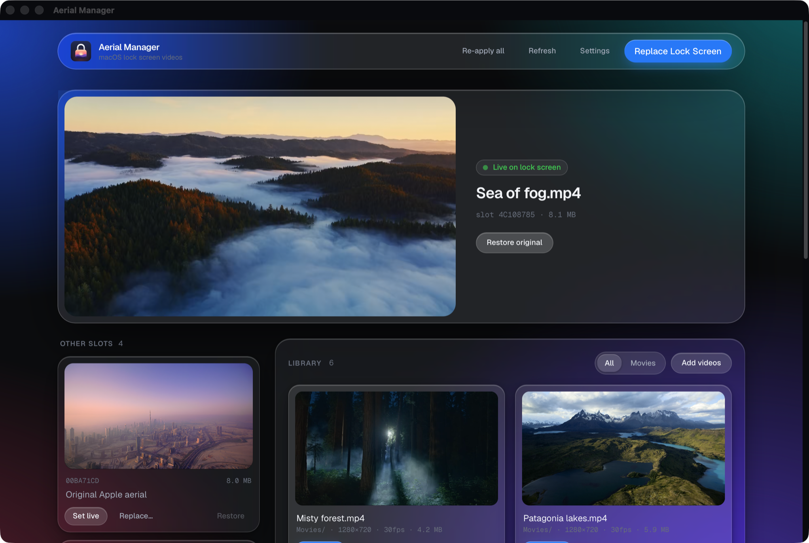

# Aerial Manager

Put **your own videos on the macOS lock screen** — a small menu-bar app.



macOS plays "aerial" videos on the lock screen and as a screen saver. On **macOS 26 (Tahoe)** the downloaded aerial videos live in a user-writable folder:

```
~/Library/Application Support/com.apple.wallpaper/aerials/videos/<UUID>.mov
```

Aerial Manager swaps those files with videos of your choice (converted to the HEVC `.mov` the lock screen plays), backs up the Apple originals automatically, and lets you pick which slot the lock screen displays.

## Features

- **One-click replace** — pick a video and it becomes your lock screen
- **Video library** — browse your video folders with hover-to-play previews; add videos by picking or dropping them
- **Slot board** — see what is inside each aerial slot and which one is live, with previews
- Apply any video to any slot, restore Apple originals from backup at any time
- Switch the displayed slot without opening System Settings
- **Re-apply all** — re-run every custom slot through the current conversion
- Videos in formats a `.mov` can't hold (e.g. AV1) are converted to H.264 in the background
- **Keeps the lock screen playing** — refreshes the wallpaper when the Mac wakes or locks, from the menu bar, and can open at login

## Requirements

- **macOS 26 (Tahoe)** — earlier versions store aerials in a root-owned location (`com.apple.idleassetsd`) and are not supported
- **At least one aerial wallpaper downloaded** — System Settings → Wallpaper → pick any aerial. Each downloaded aerial becomes a replaceable slot.

## Install

1. Download the `.dmg` from [Releases](https://github.com/kimmjen/aerial-manager/releases) and drag **Aerial Manager** into Applications. It runs on Apple Silicon and Intel, and ffmpeg is included.
2. The app is not signed yet, so macOS blocks the first launch. Open it once, then go to **System Settings → Privacy & Security** and click **Open Anyway**. (Or run `xattr -dr com.apple.quarantine "/Applications/Aerial Manager.app"`.)
3. On first launch, pick the folders that hold your videos. Then click **Replace Lock Screen**, pick a video, and lock your screen (Ctrl+Cmd+Q).

Closing the window keeps the app in the menu bar; quit it from the menu-bar icon.

**Coming from the old web version?** In Settings, use **Import slots.json** (its `data/slots.json`) so Restore keeps working, and remove the old wake helper when the app offers to.

## Settings

| Setting | Default | |
| --- | --- | --- |
| Library folders | `~/Movies` | Folders shown in the library. New videos are copied into the first one. |
| Backups of Apple originals | `~/.aerial-manager/backups` | Where originals are backed up before the first overwrite. |
| Refresh on lock | on | Restart the wallpaper every time the screen locks (it always does after waking). |
| Open at login | on | Start hidden in the menu bar. |

They are stored in `~/Library/Application Support/io.github.kimmjen.aerial-manager/config.json`, next to `slots.json` (which of your videos is inside which slot) and `wake.log`.

## How it works

1. Your video is prepared for the lock screen: landscape HEVC is copied as-is (`ffmpeg -c copy`, no quality loss); anything else is re-encoded to HEVC with VideoToolbox, capped at 30 fps, scaled down to 1080p, and portrait/square videos are blur-padded to 16:9. Applying never modifies your library file.
2. The target slot's `<UUID>.mov` is replaced in place; the Apple original is backed up first.
3. `WallpaperAgent` is restarted so the change takes effect immediately.
4. "Set live" rewrites the selected `assetID` inside `~/Library/Application Support/com.apple.wallpaper/Store/Index.plist`.

## Caveats

- Thumbnails in System Settings still show Apple's original previews; the played video is yours.
- The lock screen and desktop share one aerial: macOS animates it on the lock screen and shows a paused frame on the desktop. macOS has no option for a video lock screen with a separate still desktop picture, so this app can't do that either.
- Always apply videos through the app so they are converted to the format the lock screen expects (HEVC `.mov`). A video in another format can leave a grey desktop or a black lock screen.
- macOS updates or wallpaper re-downloads may overwrite replaced slots — just re-apply.
- The lock-screen aerial sometimes fails to resume after sleep — a macOS issue that affects Apple's own aerials too. The app works around it by restarting the wallpaper on wake and lock, so keep it running (Open at login).
- Everything happens in user-space (`~/Library`); no sudo, no SIP changes.

Use at your own risk — this modifies files inside `~/Library/Application Support/com.apple.wallpaper`. Originals are always backed up before the first overwrite.

## ffmpeg

The bundled ffmpeg is an LGPL build made from source by [`scripts/build-ffmpeg.sh`](scripts/build-ffmpeg.sh); its license, source version and build options are inside the app at `Contents/Resources/licenses/`. If Homebrew ffmpeg is installed, the app uses that instead.

## Development

Needs Node.js 20+, [Rust](https://rustup.rs) and ffmpeg (`brew install ffmpeg`) for development builds.

```bash
npm install
npm run dev                    # run the app (Vite on :1430 + Tauri)
npm run lint                   # eslint + tsc
(cd src-tauri && cargo test)   # Rust unit tests
```

Release builds bundle ffmpeg: `sh scripts/build-ffmpeg.sh universal .ffmpeg-out`, then `sh scripts/stage-ffmpeg.sh` for each target triple and `npm run build -- --config src-tauri/tauri.release.conf.json` (see [`.github/workflows/release.yml`](.github/workflows/release.yml)). Pushing a `v*` tag builds a universal `.dmg` onto a draft GitHub Release.

## License

[MIT](LICENSE)
